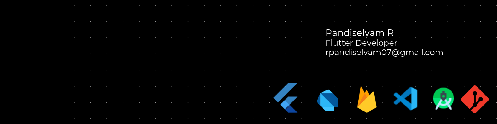

# 👋 Hi, I'm Pandi Selvam

<h3 align="center">Flutter Developer | Mobile Application Developer</h3>

  

  <a href="mailto:rpandiselvam07@gmail.com">📧 Email</a> •
  <a href="https://www.linkedin.com/in/pandiselvam-r-316928250/">💼 LinkedIn</a> •
  <a href="https://pandiselvam-portfolio.web.app/">🌐 Portfolio</a> •
  <a href="https://www.instagram.com/pandi_selvam_07/">📸 Instagram</a>

---

### 🚀 About Me

I'm a **Flutter Developer with 2+ years of experience** building and deploying cross-platform applications for Android, iOS, and Windows.

I enjoy transforming ideas into reliable, user-friendly applications with clean UI, scalable architecture, and efficient backend integrations.

- 💻 Developed and published **4 production Flutter applications** on Google Play Store and Apple App Store.
- 📱 Experienced in building Android, iOS, and Windows desktop applications.
- ⚡ Skilled in state management using **BLoC, Riverpod, and GetX**.
- 🔌 Experienced in REST API integration, Firebase, and real-time data synchronization.
- 💾 Specialized in offline-first applications using SQLite, offline API queues, and automatic data synchronization.
- 🗺️ Integrated Google Maps, GPS tracking, and location-based features.
- 🌍 Experienced in multilingual application development (English & Arabic).
- 🛠️ Familiar with Git, GitHub Actions, CI/CD, Postman, and app deployment.

---

### 🧰 Tech Stack

**Languages & Frameworks**

  
  
  
  

**State Management & Architecture**

  
  
  
  
  

**Backend & Database**

  
  
  
  

**Tools & Platforms**

  
  
  
  
  
  
  

---

### 💼 Featured Projects

**1. UngaRent – Property Rental Application**

- Cross-platform property rental marketplace connecting tenants and property owners.
- Implemented property discovery using Google Maps and advanced search filters.
- Developed role-based workflows, authentication, property listings, and favorites.

**Tech:** Flutter, Dart, BLoC, REST API, Dio, Google Maps, SharedPreferences.

**2. Brake Time Cinemas – Cinema Food & Vendor App**

- Developed a live kitchen order management dashboard.
- Implemented real-time order tracking and rush-hour queue prioritization.
- Built menu management, sales analytics, payment history, and thermal receipt printing.

**Tech:** Flutter, Dart, BLoC, REST API, Dio, Socket.

**3. E-Daddy One – Connected Mobility & EV Application**

- Developed a connected EV application with real-time vehicle telemetry.
- Implemented GPS tracking, route visualization, and trip playback.
- Integrated remote vehicle controls, safety alerts, and battery notifications.
- Added English and Arabic localization.

**Tech:** Flutter, Dart, BLoC, REST API, Google Maps, Firebase.

**4. CND Partner – Vehicle Service Management App**

- Developed vehicle cleaning assignment and service management workflows.
- Implemented camera capture with SQLite local storage.
- Built offline API queues to store captured images and pending requests.
- Implemented automatic synchronization and queued image uploads when internet connectivity is restored.

**Tech:** Flutter, Dart, BLoC, REST API, SQLite, Camera Integration, Offline API Queue.

---

### 🏆 Highlights

- 🚀 Published 4 production Flutter applications on Google Play Store and Apple App Store.
- 💻 Developed Windows desktop healthcare management software.
- ⚡ Experienced in offline-first application development and synchronization.
- 🗺️ Implemented GPS tracking and Google Maps integrations.
- 🌍 Built multilingual applications supporting English and Arabic.

---

### 📫 Let's Connect

  
  
  
  

  💡 Always interested in building impactful applications and exploring new technologies.

